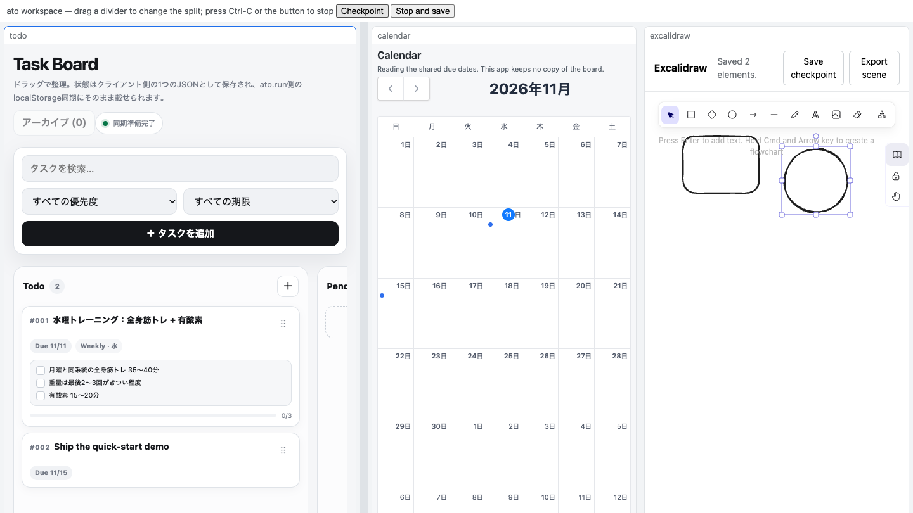

# Ato samples

Working samples for the Ato CLI, plus historical fixtures kept for reference.

[](https://ato-run.github.io/ato-samples/media/ato-quick-start-demo-v0.9.1.mp4)

## Quick start: the three-app workspace

The v0.9.1 quick-start bundle contains three capsules and a digest-pinned
`workspace.toml`:

| Pane | Sample | What it shows |
| --- | --- | --- |
| `todo` | `samples/shared-json-todo` | a task board whose state is a DataResource document |
| `calendar` | `samples/shared-json-calendar` | a separate app that reads **only** the declared `todo_list_due_dates` projection |
| `excalidraw` | `samples/excalidraw` | a whiteboard whose scene is a declared state/export operation surface |

Supported CLI: **`ato` 0.9.1**. No `npm` or Rust build is needed to try it.

1. Install the CLI from the [`ato` v0.9.1 release](https://github.com/ato-run/ato/releases/tag/v0.9.1)
   (Homebrew, shell installer or the Windows MSI).
2. Download and verify the bundle:

   ```sh
   curl -LO https://github.com/ato-run/ato-samples/releases/download/v0.9.1/ato-oss-quick-start-v0.9.1.tar.gz
   curl -LO https://github.com/ato-run/ato-samples/releases/download/v0.9.1/ato-oss-quick-start-v0.9.1.tar.gz.sha256
   shasum -a 256 -c ato-oss-quick-start-v0.9.1.tar.gz.sha256
   tar xzf ato-oss-quick-start-v0.9.1.tar.gz
   cd ato-oss-quick-start-v0.9.1
   ```

3. Open the workspace:

   ```sh
   ato workspace open workspace.toml --local-data --checkpoint-out workspace.checkpoint.toml
   ```

4. Edit the panes, press **Checkpoint** (or Ctrl-S) to save while it keeps
   running, or **Stop and save**. Resume with:

   ```sh
   ato workspace open workspace.toml --checkpoint workspace.checkpoint.toml \
     --local-data --checkpoint-out workspace.checkpoint.toml
   ```

The data (both DataResource documents and the whiteboard scene) and the split
layout come back; a pane that cannot be restored fails the resume instead of
starting empty. Cross-host continuation and the honest limits are described in
the [ato quick start guide](https://github.com/ato-run/ato/blob/main/docs/guides/quick-start-first-workspace.md)
and the [74-second demo](https://ato-run.github.io/ato-samples/media/ato-quick-start-demo-v0.9.1.mp4)
(no audio, English captions).

### Building the bundle

The bundle is produced by `.github/workflows/quickstart-bundle.yml` from these
sources: it downloads the matching `ato` release, builds the Excalidraw dist,
packs the three capsules with `ato pack` and opens the result with that CLI as
a check before uploading the artifact. Locally:

```sh
tools/build-quickstart-bundle.sh --out dist \
  --excalidraw-dist <built excalidraw dist> --samples-dir samples --version <tag>
```

The bundle also contains `bundle.json` (`ato.oss-quick-start/1`) with the
version and capsule names, and `workspace.toml` with the capsule SHA-256 pins.
Capsules are byte-identical across macOS/Linux/Windows builds.

## Current samples vs historical fixtures

`samples/shared-json-todo`, `samples/shared-json-calendar` and
`samples/excalidraw` are the **current, working** samples used above. The rest
of this repository (imported sample capsules, demos and pinned snapshot
commits) is **historical material**: it is kept because consumers still pin
those revisions, not as evidence of current CLI compatibility. The legacy
sample CI is retained only for reference; its old assertions are not release
evidence.

## Historical fixtures and pinned snapshots

- `samples/`: historical example and fixture inputs from `sample-capsules`
  (except the current `shared-json-*` and `excalidraw` directories above).
- `demos/capsule-continuation/`: interactive explanation of a Capsule and its Runs.
- `fixtures/compute-server/`: a dynamic HTTP fixture.
- `fixtures/generic-dom/`: an external-origin Browser Capsule fixture.

Each directory is an independent input. Historical example manifests and tools may refer to older CLI contracts. Their presence does not establish current compatibility. See ato-run/ato#1681 for current-CLI verification.

The fixture directories are copied from public repositories at the revisions recorded below. Existing pinned GitHub source references must remain available until consumers have been migrated and tested against this repository. No claim is made that a subdirectory import works on every existing import path.

| Source | Revision | Destination |
| --- | --- | --- |
| `ato-run/sample-capsules` | `43d89ba6fbcb56f9b70d2840068351b6d97edd25` | `samples/` |
| `ato-run/ato-capsule-demo` | `e830a25fac0b2d35aa4c4fd98653faffabb09cf4` | `demos/capsule-continuation/` |
| `ato-run/ato-e2e-compute-server` | `4f442f1ad27ae6a27eb3341283a4bb666cbdda2e` | `fixtures/compute-server/` |
| `ato-run/ato-activity-generic-dom-fixture` | `c252e15533523731d30b6cecaf91077d70046761` | `fixtures/generic-dom/` |

## Pinned root-source snapshots

Some source intake paths currently accept the repository root only. The following immutable fixture commits project the indicated directory as the root of the **new** source commit. They do not claim the original repository archive identity or replace validation of the new source. Their trees match the stated source directory exactly; each commit can be reproduced with `git subtree split --prefix=<directory> <source-commit>`. The tags make these commits reachable from this repository.

| Fixture | Source commit and directory | Root-source commit | Tag |
| --- | --- | --- | --- |
| Compute | `1090b26b8cbaf57acb7a1a18c010d3c260c78851:fixtures/compute-server` | `03b0a3577a7f8077b6480039ae4b270b8d074e9c` | `fixture-snapshot/compute-20261103` |
| Formation | `98610daf0960f0f949a7112ab675772a8793d2ed:fixtures/compute-server/formation` | `aba1022567ef4219e729248063cab84b2711c8e7` | `fixture-snapshot/formation-20261103` |
| Generic DOM | `935826385e8a43241c641278c15c598a3ceb8515:fixtures/generic-dom` | `517372400d4135d943b8ef3c75c78976bf3d5b95` | `fixture-snapshot/generic-dom-20261103` |

The Formation and Generic DOM source changes are still Draft. Source preparation was checked in staging; these snapshots have not passed actual staging Runner/Browser acceptance and do not authorize retirement of existing source URLs. Use an exact root-source commit, not a moving tag, when validating. See `docs/ops/fixture-root-source-staging-20261103.md` for the precise evidence and limitations. Broader support for selecting a subdirectory from an original archive is tracked separately in ato-run/ato-api#1096.

## Licensing

The original sample repository provides `samples/LICENSE`. The sample tools lockfile has been updated to address npm audit findings; the other imported inputs are retained as supplied, except for the revised historical index in `samples/README.md`. The other imported repositories did not include a license at the pinned revisions; this migration does not assign new reuse terms to those files. The current three-app samples are covered by the same license as the rest of this repository.
